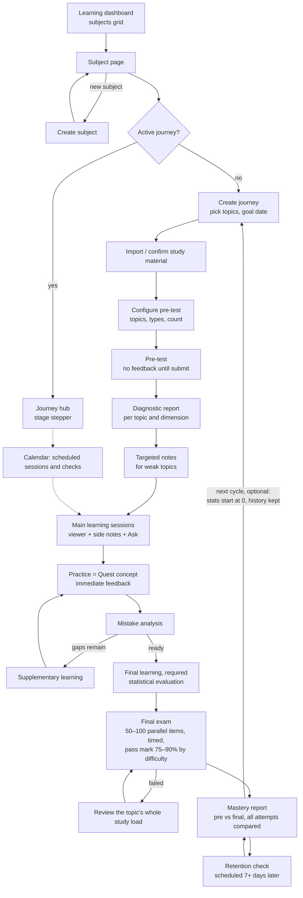
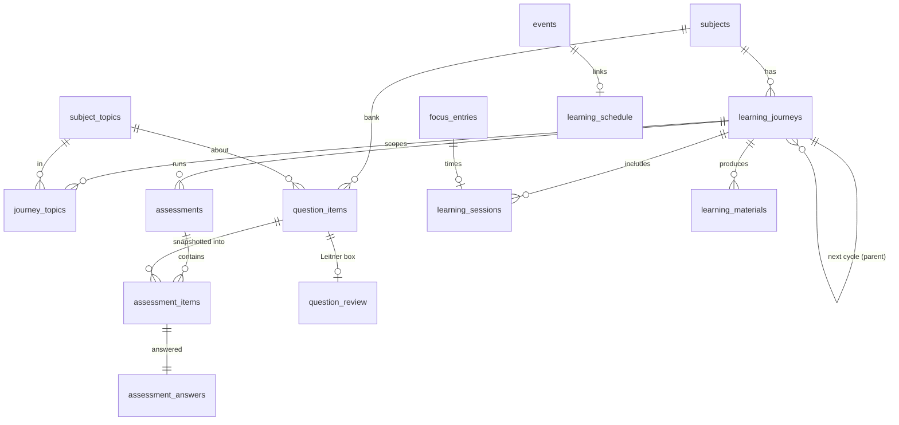

# Perflw Learning System — Product and Technical Specification

**Status:** APPROVED IN PRINCIPLE (owner decisions D1–D12, 2026-11-23; see §9). ADR-004, ADR-005, ADR-008
ACCEPTED. D6–D11 (owner's learning-loop answers, HO-011) folded in; §9.1 follow-ups answered (D13–D17); ADR-007 ACCEPTED. · **Author / architecture owner:** Claude A · **Implementation owner:** Claude B · **Date:** 2026-11-23
**Basis:** commit `e9cc8ae` (app code identical to `a54858c`) · **Related:** ADR-004 to ADR-008, tasks LS-001 to LS-030
**Naming:** code, package and data folder say **Perflw**; this spec uses that name until PF-013 is decided.

Evidence labels: **[code]** read in the source at the path given · **[proposed]** a design decision of this spec,
not yet built · **[assumption]** not verified; must be checked before it is relied on.

---

## 0. Summary

Perflw already has a strong *content* layer for learning: subjects, topics, file import, a PDF viewer with
annotations, a deterministic document analysis (sections, key points, retrieval chunks) and a grounded Q&A panel.
It has **no assessment, journey, study-session or mastery layer**: those areas are placeholders in the UI, and the
subject's "mastery %" is a number the student types in.

This spec adds that missing layer as a **repeatable learning cycle**:

```
PRE-TEST → DIAGNOSE → TARGETED NOTES → MAIN LEARNING (+ SIDE NOTES) → QUEST (practice) → RE-DIAGNOSE → FINAL LEARNING (evaluation) → FINAL EXAM → MASTERY (+ delayed retention check) → optional next cycle
```

Three principles drive every decision below:

1. **Evidence before numbers.** Mastery is computed from graded answers, shown with its evidence, and says
   "not enough evidence" rather than inventing a percentage (§5).
2. **AI is optional.** Every stage works without Ollama: manual and template questions, deterministic grading for
   closed questions, rubric self-grading for open ones, and deterministic targeted notes built from the existing
   analysis. AI adds generation and provisional grading on top, and is always labelled as such (§3.6, §6.6).
3. **Walking skeleton first.** The first milestone is one thin, complete cycle (journey → pre-test → results → study
   session → final exam → report) with deterministic question types, not a pile of polished but disconnected
   screens (§8).

---

## 1. Verified current-state audit (learning-relevant)

### 1.1 About the "HO-002 audit"
Two entries carry the number HO-002: Claude A's baseline audit (uncommitted, this worktree) and **Claude B's
"Codebase Familiarization" findings** (commit `e3412ce` on `claude/caveman-mode-ac59fd`). The first version of this
spec wrongly said no Claude B entry existed; Claude A's search missed that branch. Claude B's entry has now been
read and its learning-relevant findings verified where cited (`main.js:166`, `main.js:507`, `renderer.js:66-70`,
`workspace.js:190`, `renderer.js:1457`). Their effect on this spec is in §1.5. The numbering collision is to be
resolved at integration (HO-005).

### 1.2 What exists and works [code]

| Area | Where | What it does | Reuse for the Learning System |
|---|---|---|---|
| Subjects | `subjects` table, `src/workspace.js:166-173`; UI `src/learning.js` | Per profile (`study`/`personal`), name, type major/minor, description, image, order | The anchor of every journey |
| Topics | `subject_topics`, `src/workspace.js:179-185`, `page` column `:187`; pure rules `src/topic-model.js` | Two-level outline (topic/subtopic, plus `milestone` kind), linked to a file and page | **The unit of mastery.** Questions, mistakes and mastery are per topic |
| Files | `subject_files`, `src/workspace.js:174-178`, preview columns `:189` | Uploaded PDF/DOCX/PPTX/MD/TXT, extracted text, Office→PDF preview | Source material for questions and notes |
| Topic import | `src/learning-import.js` | Outline from Word headings, PPTX sections/titles, PDF bookmarks, Markdown | Builds the topic list a journey scopes |
| Document analysis | `src/learning-intel.js` (`analyze` at `:790`) | Deterministic: numbered sections, description + ranked key points per section, main points, keywords, retrieval chunks | **Template questions and deterministic targeted notes** (no AI needed) |
| Analysis workflow | `src/learning-workflow.js` | Queue, per-file `.md`, subject "information center" `SUBJECT.md`, AI overview (enrich), picture OCR | Notes storage pattern, `runAgent` call pattern |
| Grounded Q&A | `learning-workflow.js:546` `ask`; UI `src/learning-study.js` | Answers only from the subject's files with sources; second broad run; NOT_IN_FILE warning | Becomes the "ask while studying" tool in sessions; its source-reference format is reused for provenance |
| Learning agents | `src/learning-agents.js` | Creates editable agent packages + skills per account (Document Analyzer, Subject Assistant) | Same pattern for the new Question Writer and Answer Grader agents |
| AI gateway | `src/automation/ecosystem.js:296` `runAgent` | Resolves the agent's provider/model; throws a plain-language error if the model, connection or key is missing | All AI calls go through it; its errors define the "AI unavailable" state |
| Focus time | `focus_entries`, `active_timers`; `saveFocusEntry(userId, {…})` `src/workspace.js:682` (object argument, has a `source` field) | Timed focus sessions | **Study-session time is recorded as focus entries** with `source:'learning'` |
| Calendar | `events` table `src/workspace.js:35`; UI `src/schedule-blocks.js`; IPC `workspace:createEvent` | Time blocks in Days/Weeks views | Scheduled study and review sessions are ordinary events plus a link row |
| Planner kinds | `planner_items.kind` includes `'learning'` (`src/workspace.js:129`) | The kind exists in the schema and `PLANNER_KINDS` | [assumption] no UI writes `learning` planner items today; verify before reuse |
| Home | `renderer.js:946` "Learn" card | Links to subjects | Gets "continue journey / review due" |
| Analytics | `renderer.js:821` `renderAnalytics` | Routine and plan counts for the month only | Gets a Learning section in Phase 6 |

### 1.3 What does not exist [code]
- **No quizzes, questions, attempts, answers, journeys or study sessions.** `src/learning.js:5`: "Topics, study
  sessions and quizzes are not built yet; their areas are placeholders." The subject page shows a "Mastery
  Statistics" block saying "Charts arrive with topics and study sessions." (`learning.js:156-160`).
- **Mastery is manual.** `subjects.mastery` (0–100) and `subjects.minutes` are typed by the student in the edit
  panel (`learning.js:830-834`, `:892-894`) and displayed as "N% mastery" (`:175`, `:236`). Nothing computes them.
  This conflicts with the "no mastery without evidence" requirement → ADR-006.
- **No per-topic progress, no mistake records, no spaced review.**

### 1.4 Constraints the design must respect [code]
- **Fragile migrations** (R3, ADR-002): `CREATE TABLE IF NOT EXISTS` + column checks, no version, one
  non-rollback-safe rebuild. → New learning tables wait for PF-006 (versioned migrations). Pure modules and UI
  prototypes do not.
- **Long positional IPC signatures**: `workspace:createTask` takes 12 positional arguments and
  `workspace:createEvent` 10 (`src/preload.js:60,64`). → All new channels take **one object argument**
  (ADR-005). `saveFocusEntry` already follows this style.
- **Two storage styles for learning**: SQLite for subjects/topics/files, JSON + Markdown files for analysis and
  saved notes (`learning-workflow.js` header). → Assessment and progress data are relational and must be queried
  across topics and time, so they go in SQLite; generated *note bodies* stay Markdown files like today (ADR-004).
- **Large renderer files** (R7): `learning.js` 74 KB, `learning-study.js` 34 KB. → New UI lives in new modules
  (`learning-journey.js`, `learning-quiz.js`), each under ~600 lines.
- **E2E net failing** (R2, PF-004): UI work cannot be regression-checked until PF-004 lands.
- **Security baseline**: every new channel goes through `handle()`, re-derives the user, checks ownership of every
  id, and normalizes input in main. AI output is untrusted: it is validated against the question schema before it
  is stored and rendered as escaped text.

### 1.5 Findings from Claude B's HO-002 that shape this design [code, verified]
| Finding | Design consequence |
|---|---|
| `learning:cancelAsk` has no `requireUser()` (`main.js:507`) | Every new handler calls `requireUser()`; no handler copies an existing one without checking (PF-016 fixes the old ones) |
| Errors pass to the UI unless they match `/SQLITE\|EACCES\|ENOENT\|EPERM/` (`main.js:166`) | New store/handlers throw only plain-language messages; unexpected errors are caught and replaced (PF-017 for the rest) |
| `workspace.js:190` adds two columns guarded by one check | Fixed inside PF-006 migration 1 |
| Helpers (`esc`, `toast`, `confirmDialog`, `announce`, `reduceMotion`) live in `renderer.js` and are passed via `init(H)`; `esc` is duplicated in 7 files | New learning modules take helpers from `H`; no new copies |
| Several modules listen on `document` in capture phase | Quiz shortcuts attach to the quiz root element and ignore keys while a text field has focus |
| Motion setting is `prefs.motion` with inverted naming; some CSS ignores it | New UI checks `H.reduceMotion()` and the `body.motion-off` class, not only the media query |
| Analytics/Activities views are not reachable from navigation (`renderer.js:1457`) | LS-028 is blocked on owner decision PF-019 |
| Every persisted feature touches 5 layers with long positional arguments | Confirms ADR-005 (object arguments, one store module) |

---

## 2. User journey (A)

### 2.1 Flow diagram



### 2.2 Stages

A **journey is the whole cycle** (D7). It has one **stage** at a time. The hub shows all stages as a stepper.
Stages **unlock step by step**: a stage opens when the previous stage's exit condition is met, and the stepper shows
progress along the way (done / current / locked). The loops in §2.1 stay possible: from Mistake analysis back to
Practice or Supplementary learning, and from a failed Final exam to the review step. Locking applies to **stages
only**: notes, files and Ask stay available at every stage *[interpretation of D7]*.

| # | Stage | Entry | Student does | System records | Exit |
|---|---|---|---|---|---|
| 0 | **Learning dashboard** | Learning page | Sees subjects; each card shows the active journey stage and next action | — | Opens a subject |
| 1 | **Subject** | Subject page | Creates/edits subject (existing), manages topics and files (existing) | existing tables | "Start a learning journey" |
| 2 | **Create journey** | Subject page | Names it (default "Cycle N"), picks topics (default: all), optional target date | `learning_journeys`, `journey_topics` | Saved → stage `material` |
| 3 | **Material** | Journey hub | Confirms files are imported and analyzed (reuses upload + analysis status) | — | At least one topic has source text, or the student continues without (manual questions only) |
| 4 | **Pre-test setup** | Hub | Picks question count (default 2 per topic, max 40), types, and source: question bank / template / reviewed AI questions (D3) | `assessments` (kind `diagnostic`, status `draft`) | "Start pre-test" |
| 5 | **Pre-test** | Quiz panel | Answers; may mark "I don't know" and set confidence; may leave and resume | `assessment_answers` saved per answer | Submit → grading |
| 6 | **Diagnostic** | Results | Sees per-topic and per-dimension results, mistake categories, weak topics ranked | computed from answers | "Generate targeted notes" |
| 7 | **Targeted notes** | Hub | Reads one note per weak topic: key points + source excerpts (+ AI explanation if available) | `learning_materials` | "Start studying" |
| 8 | **Main learning** | Topic viewer | Studies a topic in the existing viewer with a session bar (timer, topic, side notes, end). Side notes are the student's own writing; optional AI help reviews them (D8, §3.8) | `learning_sessions` + focus entry; side notes in `learning_materials` | Session ends |
| 9 | **Practice** (the Quest concept) | Quiz panel | Short graded sets (5–10) targeted at weak topics; immediate feedback per question (D6). The UI says "Practice" (D17); "Quest" is the internal/spec name. A game layer (XP, streaks, rewards) is a later, separate phase (LS-031) | `assessments` kind `practice` | Any time |
| 10 | **Mistake analysis** | Results | Mistakes grouped by category and topic; "practice these again" | computed | Back to practice, or "ready for final" |
| 11 | **Supplementary learning** | Hub | Extra notes and sessions for topics still weak after practice | sessions, materials | Back to practice |
| 12 | **Final learning** | Hub | **Required** (D9). Sees the cycle's full statistical evaluation (§5.6) and does a review session on targeted notes + flagged mistakes | session kind `review`; evaluation computed | Evaluation viewed and review session ended → final exam unlocks |
| 13 | **Final exam** | Quiz panel | **Parallel items** (same topics/dimensions, different questions); 50–100 items chosen by the student, computed time limit, pass mark 75–90% by difficulty; retake only after reviewing the topic's whole study load (D10, §4.9) | `assessments` kind `final`, `attempt` n | Submit → passed / not passed |
| 14 | **Mastery report** | Results | Pre vs final per topic and dimension, evidence counts, provisional grades flagged; **every final attempt compared** (D10) | computed | Schedule retention check; optionally start next cycle |
| 15 | **Retention check** | Quiz panel | 7+ days later: short recall-only set on mastered topics | `assessments` kind `retention` | Updates retention evidence |
| 16 | **Next cycle** (optional, D11) | Report | The student chooses whether to start one. If not, the journey stays completed and its stats stay as they are. If yes: a new journey, topics pre-filled with those not yet mastered but freely editable; the new cycle's stats start at 0 (soft reset, §5.4) | `parent_journey_id` | Stage 2 |

**Calendar** (stages 8, 9, 15): any session or check can be scheduled from the hub; it becomes a calendar event
(§7.1).

---

## 3. UI/UX specification (B)

Follows `C:/Users/Maurice/.claude/Claude-Handoff/DESIGN-PREFERENCES.md` and the existing Perflw visual language
(`styles.css`, `learning.css`): restrained, compact, few visible buttons, short tooltips, clear state, keyboard and
touch usable, `prefers-reduced-motion` honored. No Google branding or assets; the Gemini quiz panel is used only as
an interaction reference (focused card, progress, navigation, check/next, explanation).

**Binding (owner decision D12, 2026-11-23): the Learning System looks like the current app.** Every new screen
(journey hub and stepper, quiz panel, results and evaluation, session bar, side notes, final exam, and later the
Quest game layer) reuses the existing tokens, components, layout patterns and motion from `styles.css` and
`learning.css`. No new visual language, no new design system, no new token set. A new CSS rule is allowed only
when no existing pattern fits, uses existing tokens, and is named in the task's handoff. Acceptance for every
renderer task: screenshots side by side with the existing Learning pages at 1280 px and 400 px (TASK_QUEUE S7).

### 3.1 Information architecture

```
Learning (rail icon, existing)
└─ Subjects grid (existing)            card adds: journey stage chip + "Next: …" line
   └─ Subject page (existing)
      ├─ Topics (existing)             adds: per-topic mastery chip
      ├─ Journey   [new]               replaces the placeholder blocks: stepper + next action + history
      │  ├─ Assessment setup  (sheet)
      │  ├─ Quiz panel        (focus mode, fills the main panel)
      │  ├─ Results / Report  (page)
      │  └─ Targeted notes    (opens in the existing topic viewer's Notes view)
      ├─ Question bank [new]           list + editor (manual questions; AI drafts awaiting review)
      └─ Mastery Statistics            (placeholder replaced by computed per-topic evidence)
```

No new rail icon. Learning stays one destination; journeys live inside a subject because every journey belongs to
exactly one subject.

### 3.2 Component hierarchy (new modules)

```
learning-journey.js  (renderer)   JourneyHub ─ Stepper, NextActionCard, JourneyHistory, AssessmentSetupSheet,
                                  ResultsPage (TopicTable, DimensionBars, MistakeList), MasteryReport
learning-quiz.js     (renderer)   QuizPanel ─ QuizHeader (title, progress, timer?, exit)
                                            ─ QuestionCard (type chip, topic, prompt, source link)
                                               └─ AnswerControl: Choice | TrueFalse | Matching | Essay | Explain
                                            ─ ConfidenceRow, FeedbackBlock
                                            ─ QuizFooter (Previous, Flag, Check|Next|Submit)
                                            ─ QuestionNavigator (dot strip / grid)
                                  CompletionView
learning-bank.js     (renderer)   QuestionList, QuestionEditor (per-type form), DraftReview
learning-session.js  (renderer)   SessionBar (inside the existing topic viewer), SideNotes
```

### 3.3 Quiz panel layout

```
┌──────────────────────────────────────────────────────────────────────────┐
│ ✕  Pre-test · Chemical Bonding                    Question 3 of 12  ▓▓▓░░ │  header
├──────────────────────────────────────────────────────────────────────────┤
│  MULTIPLE CHOICE · Ionic bonds                                  ⚑ Flag    │
│                                                                          │
│  Which property best explains why NaCl has a high melting point?         │  question card
│                                                                          │  (max-width ~720px,
│  ( A )  Weak intermolecular forces                                       │   centered)
│  ( B )  Strong electrostatic attraction between ions          ◉          │
│  ( C )  Shared electron pairs                                            │
│  ( D )  Metallic bonding                                                 │
│                                                                          │
│  How sure are you?   ○ Guessing   ● Fairly sure   ○ Certain              │  confidence
├──────────────────────────────────────────────────────────────────────────┤
│  ← Previous        ● ● ◐ ○ ○ ○ ○ ○ ○ ○ ○ ○            Next →  / Submit   │  footer + navigator
└──────────────────────────────────────────────────────────────────────────┘
```

- **Focus mode**: the quiz fills the main panel; sidebar collapses; `Esc` or ✕ asks "Leave? Your answers are saved"
  (built-in confirm row, not `confirm()`).
- **Progress**: "Question n of N" + thin bar = answered / total (not position).
- **Navigator**: one dot per question: empty = unanswered, filled = answered, ring = current, small flag = flagged.
  Click/Enter jumps. On narrow widths (<600px) it collapses to "3 / 12 ▾" opening a grid.
- **Footer button** by mode: Diagnostic/Final → `Next`, and `Submit` on the last question or from the navigator
  (shows "4 unanswered" before submitting). Practice → `Check`, then `Next` after feedback.
- **Keyboard**: `1–9`/`A–D` choose an option; `T`/`F` true/false; `←`/`→` previous/next (not while typing);
  `Ctrl+Enter` check/submit; `F` toggles flag when not in a text field. Handlers attach to the quiz root, never
  `document` capture (§1.5); letter shortcuts are ignored while a text field has focus. All controls reachable by Tab, visible focus
  ring, `role="radiogroup"` for choices, live region announces "Correct"/"Incorrect"/"Saved".

### 3.4 Answer controls per type

| Type | Control | Notes |
|---|---|---|
| Multiple choice | Radio cards (single) or checkbox cards when `multiple:true` | Options shuffled per attempt (seeded, stored) |
| True / false | Two large segmented buttons | Optional "justify" text field when `requireJustification` |
| Connect / matching | Two columns; select a left item then a right item to connect; connected pairs shown as chips with ✕ to undo. Drag is an enhancement, never the only way | Right column shuffled; touch targets ≥ 44px |
| Essay | Textarea with word counter and target range; rubric shown collapsed ("What a good answer covers") only in practice | Autosave every 2 s idle |
| Explain / describe | Shorter textarea (1–5 sentences) | Same autosave |
| All | "I don't know" link (records `dontKnow:true`, counts as not known, not as a wrong guess) | Separates no-knowledge from misconception |

### 3.5 Feedback states

| State | When | Visual |
|---|---|---|
| Unanswered | — | neutral card |
| Saved | answer stored (diagnostic/final) | subtle "Saved" text in footer, no correctness shown |
| Correct | practice, after Check | green left rule + ✓ + explanation + source link |
| Incorrect | practice, after Check | red left rule + correct answer + explanation + source link |
| Partial | matching partly right, rubric partly met | amber; shows which pairs/criteria |
| Grading… | open answer sent to AI | spinner line "Grading with <model>…", Next still enabled |
| Provisional | AI grade returned | amber chip "AI grade · provisional" + per-criterion reasons + "Adjust" |
| Self-grade | no AI | rubric checklist; the student ticks criteria they met; chip "Self-graded" |
| Final | deterministic, accepted, or manually adjusted | normal chip |

Color is never the only signal: every state has an icon and a word.

### 3.6 Empty, loading, error, unavailable

| Case | Message and action |
|---|---|
| Subject has no topics | "Add topics or import a file to start a journey." → Import / Add topic |
| Journey topics have no source text | "These topics have no text to build questions from. Write your own questions or import the file." → Question bank |
| Question source has too few items | "Only 5 questions are available for 8 topics. Start with 5, or add more." |
| AI unavailable (no model / Ollama off / key missing) | The `runAgent` error text, plus: "You can still use your own questions and template questions; open answers will be self-graded." AI buttons disabled with a tooltip, never hidden silently |
| AI returned invalid output | "The model's questions were not usable. Try again or write your own." The raw text is not shown or stored |
| Grading failed | Answer stays saved with status `pending`; "Grade later" retries; self-grade offered |
| Loading | skeleton card in the quiz; results page shows "Calculating…" only if > 300 ms |
| Save failed | inline "Not saved — Retry"; the answer stays in memory and the quiz cannot submit until saved |

### 3.7 Results and analytics screens

- **Diagnostic / final results**: score line ("18 of 24 points · 3 open answers provisional"), a **topic table**
  (topic, items, correct, level chip, main mistake category), **dimension bars** (Recognition, Recall,
  Understanding, Application) each with "n items" beneath, and **Review answers** (the quiz panel read-only with
  feedback).
- **Mastery report**: per topic: pre-test level → final level → retention, with arrows; evidence count; a short
  "How this is calculated" link opening §5 in plain words. No single subject-wide percentage unless every topic has
  enough evidence (§5.4).

### 3.8 Study session interface

Inside the existing topic viewer (no new page): a slim **SessionBar** above the document: topic name, elapsed
time, "Side note" button, "End session". Side notes open a small editor in the AI panel's Notes view, tagged to
the session and the current page.

**Side notes (D8).** A side note is the **student's own writing**. It is separate from targeted notes (weakness
notes) and from PDF highlights/annotations. Optional AI help ("Check my note") reads the note and its cited pages
and returns suggestions: gaps, unclear points, a short explanation. Rules *[interpretation of D8]*:
- AI never writes into the student's note. Its suggestions are stored as their own record (`side_note_ai`, linked
  to the note, with provenance, §6.4) and shown beside it.
- The student may copy a suggestion in by hand; the note stays theirs. The UI labels AI suggestions "AI · suggestion".
- Without AI, side notes work fully; only "Check my note" is unavailable.

Ending a session shows a 3-field summary (duration, topics, notes) and "Practice
this topic now". A session left running is closed on app exit at its last activity time (no ghost hours).

### 3.9 Responsive and accessible
- Quiz card max-width 720px, side gutter ≥ 16px, works at 400px wide; matching stacks into one column with "Connect
  to…" menus below 600px.
- WCAG 2.1 AA contrast. Pre-tests, practice sets and retention checks are untimed. The **final exam is timed** by default
  (D10, §4.9): remaining time shown, warnings at 5 and 1 minutes, announced politely. Before starting, the student
  can choose ×1.5, ×2 or untimed (D16, WCAG 2.2.1); the choice is stored in the attempt's `config` and the attempt is
  labelled in results and comparisons ("Time ×1.5", "Untimed").
- Motion: card change = 150 ms fade/slide, disabled under `prefers-reduced-motion`.

---

## 4. Assessment engine (C)

### 4.1 Assessment kinds

| Kind | Purpose | Item source | Feedback | Counts toward mastery | Reuse of items |
|---|---|---|---|---|---|
| `diagnostic` | Pre-test and re-diagnosis: what is already known | bank / template / AI | **After submit only**: per-topic results and per-question correctness + explanation | Yes, as **baseline** (stage `pre`) | Items used in a diagnostic are excluded from that journey's final exam |
| `practice` (UI: **Practice**, D17; Quest concept, D6) | Learning by retrieval | prefers weak topics and past mistakes | **Immediately**, after each Check | Yes, weighted 0.5 (help visible, retries allowed) | Any; mistakes come back (spaced) |
| `final` | Demonstrate understanding at the end of a cycle; 50–100 items, timed, pass mark, retakes (§4.9) | bank / template / AI, **parallel items** | After submit only; open answers need final grades before the report is "final" | Yes, weight 1.0; every attempt kept | Never items seen in this journey's diagnostic; a retake prefers items not used in earlier attempts |
| `retention` | Delayed retrieval (≥ 7 days after final) | recall / understanding items on topics the final rated Proficient+ | After submit | Yes, as the **retention** dimension | Items not seen in the last 7 days |

### 4.2 Question data structure [proposed] (`src/assessment-model.js`, pure, unit-tested)

```js
// Common fields (every type)
{
  id, subjectId, topicId,                 // topicId may be null only for subject-wide questions
  type: 'choice' | 'truefalse' | 'matching' | 'essay' | 'explain',
  prompt: string (1–2000),
  dimension: 'recognition' | 'recall' | 'understanding' | 'application',
  difficulty: 1 | 2 | 3,
  explanation: string (0–2000),          // shown after answering
  points: number (1–20; default per type),
  source: [{ fileId, docId, section, page, quote }],   // 0–5 refs, quote ≤ 300 chars
  origin: 'manual' | 'template' | 'generated',
  provenance: { provider, model, agentId, promptVersion, generatedAt } | null,   // required when generated
  status: 'active' | 'retired',
  review: 'approved' | 'unreviewed' | 'rejected',
      // D3 (approved): manual and accepted template questions are 'approved'; generated questions start
      // 'unreviewed'. Practice may use 'unreviewed' (shown with an "AI · not reviewed" chip); diagnostic, final and
      // retention use only 'approved'. A person approves, edits (→ approved) or rejects in the question bank.
  payload: <type-specific, below>
}

// choice
payload: { options: [{ id, text }] (2–8), correct: [optionId…] (≥1), multiple: boolean }
// truefalse
payload: { statement, correct: true|false, requireJustification: boolean }
// matching
payload: { left: [{ id, text }] (2–10), right: [{ id, text }] (≥ left, ≤ 12 incl. distractors), pairs: [[leftId, rightId]…] }
// essay
payload: { minWords, maxWords, rubric: [{ id, criterion, points, keywords?: [] }] (1–8) , modelAnswer? }
// explain
payload: { maxWords (default 120), rubric: [...] (1–5), modelAnswer? }
```

`validateQuestion(q)` returns `{ ok, errors[] }` and is the **only** gate for manual, template and AI questions.
A response:

```js
{ questionId, choice?: [optionId], value?: boolean, justification?: string,
  pairs?: [[leftId, rightId]], text?: string, dontKnow?: boolean, confidence?: 1|2|3, timeMs }
```

### 4.3 Evaluation rules

| Type | Grader | Rule | Score |
|---|---|---|---|
| Choice (single) | deterministic | selected === correct | 0 or points |
| Choice (multiple) | deterministic | partial credit: (correct picks − wrong picks) / correct count, floored at 0 | 0…points |
| True/false | deterministic | value === correct; justification (if required) graded like `explain` with a 1-criterion rubric, worth 50% | 0…points |
| Matching | deterministic | each correct pair = points / pairs.length | 0…points |
| Essay | AI (provisional) or self | sum of met rubric criteria points; each criterion: `met` / `partly` (½) / `missing` | 0…points |
| Explain | AI (provisional) or self | same as essay | 0…points |
| Any | — | `dontKnow` → 0, category `not_known`; empty answer at submit → 0, category `not_answered` | |

Grading is a pure function `grade(question, response) → { score, max, status, criteria?, category? }` for the
deterministic types; open types return `status:'pending'` and go to the grader queue.

### 4.4 AI and self-grading of open answers

- **Prompt contract** (new skill `learning-answer-grading`): input = question, rubric, model answer, the student's
  answer, source excerpts; output = strict JSON `{ criteria: [{ id, verdict: met|partly|missing, reason }],
  confidence: low|medium|high }`. Output that fails JSON or schema validation → `pending`, never a guessed score.
- The score is computed **by code from the verdicts**, never taken from the model as a number.
- Stored as `grade_status:'provisional'`, `grader:'ai'`, with the model and confidence. UI says "AI grade ·
  provisional" and shows each reason.
- The student can **Accept** (→ `final`, grader `ai+accepted`) or **Adjust** criteria (→ `final`, grader
  `manual`). Adjustments are kept as-is; the original AI verdict is kept in `feedback` for audit.
- `confidence: low` grades are excluded from mastery until accepted.
- **Without AI**: the rubric is shown as a checklist after the answer; the student ticks what they covered
  (`grader:'self'`, `final`). Self-grades count toward mastery at weight 0.75 (self-assessment is less reliable;
  stated in the report).

### 4.5 When answers are evaluated and feedback revealed

| Event | Diagnostic / Final / Retention | Practice |
|---|---|---|
| Answer changed | saved (debounced), not graded | saved, not graded |
| Check pressed | — | graded now; feedback shown; answer locked; "Try again" allowed once for deterministic types (second attempt scored ×0.5) |
| Submit | all answers graded; open answers queued for AI or self-grade | — |
| Results visible | right after submit; open answers show "Grading…" until done | per question |
| Correct answers visible | after submit | after Check |

### 4.6 Assessment lifecycle

```
draft ──start──► in_progress ──submit──► submitted ──all graded (final/provisional)──► graded
   │                 │  ▲ resume                                    │
   └──delete         └──abandon (kept, excluded from mastery)       └── provisional → final when every open answer is accepted/adjusted
```
Items are **snapshotted** into the assessment when it starts (`question_snapshot` JSON), so editing or retiring a
question later never changes a past result.

### 4.7 Item selection
`selectItems({ topics, count, types, dimensions, exclude, weakTopics })` (pure): round-robin over topics so every
topic gets at least one item; within a topic, spread across dimensions (diagnostic needs at least one recall-or-
higher item per topic so recognition-only evidence cannot dominate); exclude items already used per §4.1;
practice weights weak topics ×2 and due mistakes first.

### 4.9 Final exam rules (D10) [proposed formulas; defaults in a frozen, versioned `DEFAULT_EXAM_CONFIG`, D4-style]

The owner set the ranges; the formulas below are Claude A's proposal for "depending on how hard and how many".

- **Item count:** the student picks a number from **50 to 100** *[interpretation: "range 50–100" = item count]*.
  If the bank has too few eligible items (approved, not used in this journey's diagnostic), the setup sheet says
  how many are missing per topic and offers bank / template / AI (LS-023). The 50–100 range is enforced from LS-023;
  before that (M-L1, LS-010) a small test final is allowed (D15).
- **Difficulty** of an exam = mean `difficulty` (1–3) of its items, `d̄`.
- **Time limit** = Σ per-item base time × difficulty factor, rounded up to 5 minutes.
  Base: choice 60 s, true/false 45 s (+90 s with justification), matching 30 s per pair, explain 180 s,
  essay 60 s per 50 words of `maxWords`. Factor: difficulty 1 → 0.8, 2 → 1.0, 3 → 1.3.
  Example: 50 single-choice items at difficulty 2 → 50 × 60 s × 1.0 = 50 min.
  On time-out the saved answers are submitted.
- **Pass mark** = 75% + 7.5% × (d̄ − 1), so d̄ = 1 → 75%, 2 → 82.5%, 3 → 90%; rounded to 0.5%.
  Passed = exam score ÷ max ≥ pass mark. The pass mark and `d̄` are stored in the attempt's `config`.
- **Retake:** allowed after a failed attempt once the student has **reviewed the whole study load** of every exam
  topic below the pass mark. **Checked by the app (D13):** after the failed attempt, every section of each such
  topic's files was opened in a `review` session, and each of its targeted notes was opened. Source: the sessions'
  `visited` records (§6.2); `assessment:retakeStatus` lists what is still missing. Each retake is a new `assessments` row with `attempt` + 1 and
  `retake_of` pointing to the previous attempt. Nothing is overwritten.
- **Comparison:** the report shows every attempt side by side: score, pass mark, time used, per-topic and
  per-dimension change between attempts.
- **Pass vs Mastered:** passing is an exam-level result. "Mastered" stays a per-topic level (§5.4) that also needs a
  retention check. They stay **separate rules** (D14): the exam pass mark is 75–90% on the whole exam; a topic is
  Mastered at ≥ 80% on its final items plus a retention check (§5.4).

### 4.8 Where questions come from
1. **Manual** (question bank editor): always available.
2. **Template** (deterministic, from `learning-intel` analysis, no AI) [proposed]:
   - *Explain* from a section: "Explain {section title} in your own words." Rubric = that section's key points
     (each a criterion, 1 point). Dimension `recall`/`understanding`.
   - *True/false* from a key point: the key point as-is = true. (No automatic "false" variants: inventing false
     statements deterministically is error-prone.)
   - *Matching* from sections: left = section titles, right = their descriptions (3–6 pairs from one file).
   - These are labelled `origin:'template'` and can be edited.
3. **AI-generated** (new agent "Learning Question Writer", skill `learning-question-writing`): input = topic,
   section text excerpts, requested types/dimensions/difficulty; output = JSON questions validated by
   `validateQuestion`; each must cite a source chunk present in the input (checked by code, else rejected).

---

## 5. Learning intelligence and mastery methodology (D)

### 5.1 Dimensions (what each measures and which evidence counts)

| Dimension | Meaning | Evidence |
|---|---|---|
| **Recognition** ("familiarity") | Can identify the right answer when shown | choice, true/false, matching |
| **Recall** | Can retrieve it without cues | explain (definition/describe), true/false justification |
| **Understanding** | Can explain why/how, relate ideas | explain, essay tagged `understanding` |
| **Application** | Can use it in a new case | choice or essay tagged `application` (scenario) |
| **Retention** | Still knows it later | recall/understanding items answered in a `retention` assessment ≥ 7 days after the last time the topic was practised |

Recognition is deliberately separated: a student can recognize every answer and still fail to explain one.

### 5.2 Mistake categories (deterministic rules, `src/learning-insight.js`, pure)

| Category | Rule |
|---|---|
| `not_known` | "I don't know" or blank text |
| `misconception` | wrong with confidence 3 (certain) |
| `guess` | correct with confidence 1 (counted correct, flagged as unreliable; weight ×0.5) |
| `confusion` | choice: picked a distractor that is the correct answer of another question in the same topic; matching: swapped pairs |
| `partial` | open answer or matching with 0 < score < max |
| `recognition_only` | topic has recognition items correct but recall/understanding items wrong in the same assessment |
| `forgotten` | correct in final/practice, wrong in a later retention check |
| `incorrect` | any other wrong answer |

AI may add a one-line explanation of a mistake in practice feedback, but the **category is always assigned by
code**, so the analysis works offline and is reproducible.

### 5.3 Weak topics, targeted notes, recommendations
- **Weak topic** = level Not assessed/Emerging/Developing after the latest diagnostic, or any `misconception`.
  Ranked by (misconceptions × 2 + wrong + not_known) / items.
- **Targeted note** (deterministic, always available) per weak topic: the topic's section description and key
  points from the analysis, the source excerpts cited by the missed questions, and the student's mistakes
  ("You answered… The source says…"). Stored as Markdown (`learning_materials`).
  **AI enhancement** (optional): an explanation section written by the Subject Assistant constrained to those
  excerpts (same grounding rule as Ask), labelled with its model.
- **Practice recommendation**: weak topics first; mistakes resurface after 1, 3, 7, 14 and 30 days (five Leitner boxes
  per question: correct moves up a box, wrong resets to box 1). No SM-2 or ML; easy to explain and test.

### 5.4 Topic-level mastery calculation

**Scope: one cycle (D11, soft reset).** A topic's mastery is computed from the answers of **its current journey
(cycle)** only, so a new cycle starts the topic's stats at 0. Earlier cycles and every attempt stay stored and are
shown as history and comparison (journey history, LS-022; attempt comparison, §4.9). Nothing is deleted.
Assessments without a journey (e.g. a practice set started from the subject page) belong to the active journey of that
subject when one exists; otherwise they appear only in history.

For each topic, over **graded, non-abandoned** answers of that scope (provisional AI grades with low confidence excluded):

1. **Item score** `s = score / max` (0…1).
2. **Weight** `w = kindWeight × graderWeight × guessWeight × recency`
   - kindWeight: diagnostic 1.0, final 1.0, retention 1.0, practice 0.5
   - graderWeight: deterministic/accepted/manual 1.0, AI provisional 0.75, self 0.75
   - guessWeight: 0.5 if confidence 1 and correct, else 1.0
   - recency: `0.5 ^ (ageDays / 30)` (an answer loses half its weight in 30 days)
3. **Dimension score** `D = Σ(w·s) / Σw` per dimension that has ≥ 2 items; otherwise "no evidence".
4. **Level** (not a raw percentage):

| Level | Requires |
|---|---|
| Not assessed | fewer than 3 graded items on the topic |
| Emerging | otherwise, if no higher level applies |
| Developing | Recognition ≥ 0.6 **and** at least one of Recall/Understanding ≥ 0.4 |
| Proficient | Recall ≥ 0.7 **and** Understanding ≥ 0.6, with ≥ 6 graded items on the topic |
| Mastered | Proficient **and** final-exam topic score ≥ 0.8 **and** a retention check ≥ 7 days later with Recall ≥ 0.7, and every open answer counted is `final` |

   *Cap rule:* recognition-only evidence can never exceed Developing.
5. **Displayed number**: next to the level, the report may show "Recall 72% · 8 items"; the evidence count is
   always shown. A **subject-wide** figure is shown only when every journey topic is at least "Emerging", as
   "n of m topics Proficient or better" — never as an averaged percentage.
6. **Improvement** = per topic and dimension, final-exam D minus diagnostic D, shown only when both have ≥ 2 items.

Worked example (topic "Ionic bonds", recall dimension): diagnostic 1/2 explain criteria met (s=0.5, w=1.0),
practice 1/1 (s=1, w=0.5), final 3/3 (s=1, w=1.0, AI provisional ×0.75 = 0.75).
D = (1.0·0.5 + 0.5·1 + 0.75·1) / (1.0 + 0.5 + 0.75) = 1.75 / 2.25 = **0.78** (recency ≈ 1 within days).

**Configurability (D4, approved):** every weight and threshold above lives in one frozen
`DEFAULT_MASTERY_CONFIG` (with a `version`) in `src/mastery-model.js`. Every function takes an optional `config`
argument, validated by `validateMasteryConfig`, so values can be tuned without code changes to the logic. Each
computed result records the `configVersion` it used, so a report stays explainable after thresholds change.
Changing the defaults is a reviewed code change with updated boundary tests. A user-facing setting to override them
is **not** in scope until real usage shows which values need tuning; it would be a separate task with its own
storage decision (and, if stored in the DB, a migration under G1).

**Validation through use (D4):** after M-L1, Claude A reviews real assessment data with the owner (levels vs the
student's own judgment, how often "Not assessed" appears) before Phase 5 locks the report.

### 5.5 What happens to the existing manual "mastery %" (ADR-006, D2 approved)
- The edit panel stops editing `subjects.mastery` and `subjects.minutes` (LS-025). **Both columns and their values
  are preserved** (no schema change, no data rewrite).
- Until a subject has assessment evidence, its old value is shown read-only as "Earlier self-estimate: 60% (entered
  manually)". It is never mixed into calculated mastery and never presented as measured.
- Once evidence exists, the card shows the computed summary ("3 of 7 topics Proficient+ · Cycle 2"); the old
  estimate stays visible in the journey history as a historical note.
- Study time shown = the old manual minutes (labelled "before tracking") + the sum of learning focus entries.

### 5.6 Final learning evaluation (D9)

Required before the final exam unlocks. A computed, read-only report for the current cycle (no new table), per
journey topic: pre-test score and level; current level and dimension scores (§5.4) with evidence counts; Practice
results (sets, accuracy, trend); mistakes by category (§5.2); study time and sessions (focus entries); targeted
notes read and side notes written; due reviews. A subject-level summary row follows §5.4 rule 5 (no averaged
percentage). It ends with "Ready for the final exam" items: topics still below Developing are flagged, not blocked.

---

## 6. Data and architecture (E)

### 6.1 Module boundaries [proposed]

```
Pure (no I/O, unit-tested; usable from main and, via <script>, renderer)
  src/assessment-model.js   question validation, response normalization, deterministic grading, item selection
  src/mastery-model.js      weights, dimension scores, levels, improvement
  src/learning-insight.js   mistake categories, weak-topic ranking, Leitner scheduling, targeted-note assembly
Main
  src/learning-store.js     SQLite access for all new tables (one place; no SQL in main.js)
  src/learning-coach.js     AI jobs: question generation, answer grading, note explanations (via ecosystem.runAgent)
  src/learning-agents.js    + Question Writer agent, + skills learning-question-writing / learning-answer-grading
  src/main.js               new `journey:*`, `assessment:*`, `questions:*`, `study:*` handlers (thin: auth, ownership, call store)
Renderer
  src/learning-journey.js, learning-quiz.js, learning-bank.js, learning-session.js, learning-quiz.css
```

### 6.2 Entities and relationships [proposed] (`workspace.sqlite`, migration v2 after PF-006)



| Table | Key columns (all have `id TEXT PK`, `user_id TEXT NOT NULL`, `created_at`, `updated_at`) |
|---|---|
| `learning_journeys` | `subject_id` FK→subjects CASCADE · `title` · `stage` CHECK(the 13 stage keys of §2.2 stages 3–15, `JOURNEY_STAGES`) · `status` CHECK(active, completed, archived) · `cycle` INT · `parent_journey_id` FK→self SET NULL · `target_date` · `completed_at` |
| `journey_topics` | PK(`journey_id`,`topic_id`) · FKs CASCADE |
| `question_items` | `subject_id` FK CASCADE · `topic_id` FK→subject_topics SET NULL · `type` CHECK(5) · `dimension` CHECK(4) · `difficulty` · `points` · `prompt` · `payload` JSON · `explanation` · `source` JSON · `origin` CHECK · `provenance` JSON · `status` CHECK(active, retired) · `review` CHECK(approved, unreviewed, rejected) · `reviewed_at` |
| `assessments` | `subject_id` FK CASCADE · `journey_id` FK SET NULL · `kind` CHECK(diagnostic, practice, final, retention) · `title` · `config` JSON (count, types, feedback mode, time limit, seed; for finals also pass mark, `d̄`, exam config version) · `status` CHECK(draft, in_progress, submitted, graded, abandoned) · `attempt` INT DEFAULT 1 · `retake_of` FK→self SET NULL (D10) · `started_at` · `submitted_at` · `graded_at` |
| `assessment_items` | `assessment_id` FK CASCADE · `question_id` FK SET NULL · `position` · `topic_id` · `dimension` · `max_score` · `question_snapshot` JSON (immutable) · UNIQUE(`assessment_id`,`position`) |
| `assessment_answers` | `item_id` FK CASCADE UNIQUE · `response` JSON · `confidence` · `dont_know` · `saved_at` · `score` REAL NULL · `grade_status` CHECK(pending, provisional, final) · `grader` CHECK(auto, ai, ai_accepted, self, manual) · `criteria` JSON · `feedback` JSON (incl. AI provenance and original verdicts) · `mistake_category` · `graded_at` · `attempt` INT (practice retries) |
| `learning_sessions` | `subject_id` FK CASCADE · `journey_id` FK SET NULL · `topic_id` FK SET NULL · `kind` CHECK(main, supplementary, review) · `started_at` · `ended_at` · `focus_entry_id` FK→focus_entries SET NULL · `summary` · `visited` JSON (`{ sections: [{fileId, section}], materials: [materialId] }`, appended while the session runs; the D13 retake check reads it) |
| `learning_materials` | `subject_id` FK CASCADE · `journey_id` FK SET NULL · `topic_id` FK SET NULL · `session_id` FK SET NULL · `kind` CHECK(targeted_note, side_note, side_note_ai, supplementary) · `parent_material_id` FK→self CASCADE (an AI suggestion's side note, D8) · `title` · `body_file` (Markdown under `learning-files/<account>/journeys/<journeyId>/`) · `source` JSON · `origin` · `provenance` JSON |
| `learning_schedule` | `event_id` FK→events CASCADE UNIQUE · `journey_id` FK CASCADE · `kind` CHECK(session, practice, retention, final) · `topic_ids` JSON |
| `question_review` | PK(`user_id`,`question_id`) · `box` INT 1–5 · `due_on` · `last_result` |

Indexes: `(user_id, subject_id)` on every table with `subject_id`; `(assessment_id, position)`;
`(user_id, due_on)` on `question_review`; `(user_id, topic_id)` on `assessment_items` for mastery queries.

Notes:
- **No mastery table.** Mastery is computed from answers (pure function). If it becomes slow, add a cache table
  later, rebuilt from answers, never the source of truth.
- **Answer persistence**: one upsert per answer change (debounced 600 ms in the renderer); the server rejects writes
  to submitted assessments.
- **JSON columns** are validated by the pure modules in main before writing and parsed defensively on read
  (unknown fields dropped, size caps: payload ≤ 32 KB, response ≤ 32 KB).
- **D3 review state** is its own column (`review`), separate from `status`, so retiring a question never loses
  whether a person approved it.
- **Deleting** a topic sets `topic_id` NULL on questions/items (history kept, labelled "deleted topic"); deleting a
  subject cascades everything, including journey files (same as today's `subjectRemoved`).

### 6.3 IPC contract [proposed] — one object argument each

```
journey:list {subjectId}            journey:create {subjectId, title?, topicIds, targetDate?, parentId?}
journey:get {journeyId}             journey:update {journeyId, stage?, title?, topicIds?, targetDate?, status?}
questions:list {subjectId, topicId?, status?}   questions:save {question}   questions:retire {questionId}
questions:generate {subjectId, topicIds, types, dimensions, count}         → job id; events on learning:coachEvent
questions:templates {subjectId, topicIds}       (deterministic drafts, not saved until accepted)
assessment:create {journeyId?, subjectId, kind, config}   assessment:start {assessmentId}
assessment:get {assessmentId}       assessment:saveAnswer {itemId, response}   assessment:check {itemId}
assessment:submit {assessmentId}    assessment:abandon {assessmentId}
assessment:grade {itemId, criteria} (self/manual)   assessment:acceptGrade {itemId}   assessment:regrade {itemId}
assessment:results {assessmentId}   mastery:subject {subjectId}   mastery:journey {journeyId}
study:start {subjectId, journeyId?, topicId?, kind}  study:end {sessionId}   study:sideNote {sessionId, text, page?}
study:sideNoteHelp {materialId}     (D8; AI job, returns a side_note_ai record; never edits the note)
journey:evaluation {journeyId}      (D9, §5.6)   assessment:retakeStatus {assessmentId}  (D10: what is left to review)
materials:list {journeyId}   materials:targeted {journeyId, topicIds, useAi}   materials:read {materialId}
schedule:create {journeyId, kind, startsAt, endsAt, topicIds}   (creates the event + link in one transaction)
```
Every handler: `requireUser()`, ownership check on every id (journey → subject → user), input normalized by the pure
modules, result `{ok, value}`. Results returned to the renderer never include answer keys for an in-progress
diagnostic/final (the snapshot is stripped of `correct`/`pairs`/`modelAnswer` until submit). This prevents the
answer key from being in renderer memory during an exam.

### 6.4 AI-generated content provenance
Every generated question, grade and note stores `{ provider, model, agentId, promptVersion, generatedAt }`, plus
the source references it was grounded on. The UI shows a small "AI" chip with the model name on any generated
content. Prompt versions are constants in `learning-coach.js` so a change of prompt is traceable.

### 6.5 Migration strategy (ADR-004, depends on ADR-002)
1. PF-006 lands first: `PRAGMA user_version`, ordered migrations, each in `BEGIN IMMEDIATE … COMMIT` with
   `ROLLBACK`, DB file copy before the first pending migration. Version 1 = today's schema.
2. Learning tables = **migration 2**: only `CREATE TABLE` and `CREATE INDEX`. No existing table is altered or
   rebuilt, so the risk to existing data is limited to the backup-and-version machinery itself.
3. Test: open a copy of a v1 database (fixture made from the current schema), run migrations, assert the new
   tables exist, old rows are untouched, and running again is a no-op.
4. If the owner does not approve ADR-002, fall back to `CREATE TABLE IF NOT EXISTS` for these purely additive
   tables (still safe because nothing existing is altered); this is the explicit fallback, not the plan.

### 6.6 AI optionality
| Capability | With AI | Without AI |
|---|---|---|
| Questions | manual, template, generated | manual, template |
| Closed-question grading | deterministic | deterministic |
| Open-question grading | provisional AI + accept/adjust | rubric self-grade |
| Mistake categories, weak topics, mastery | code | code |
| Targeted notes | deterministic + AI explanation | deterministic |
| Ask while studying | existing Ask | existing "AI unavailable" state |
All saved records (assessments, answers, sessions, notes) are readable and usable without any model.

---

## 7. Integration plan (F)

| Area | Integration | Mechanism |
|---|---|---|
| **Calendar** | Schedule a study session, practice, final, or retention check | `schedule:create` makes an `events` row (title "Study · Ionic bonds", theme per subject) + `learning_schedule` link in one transaction. Clicking the event offers "Start". Deleting the event deletes the link only. |
| **Planner** | Due reviews appear in today's to-do | Read-only: home/today list shows "Review: 6 questions due (Chemistry)" from `question_review.due_on`; not stored as planner items. The `learning` planner kind is left unused until the owner wants manual learning to-dos [assumption on current non-use to verify]. |
| **Home** | Learn card: "Continue: Chemistry · Practice", "6 reviews due", "Retention check on Fri" | `mastery:subject` + journey list; no new storage |
| **Statistics** | Analytics view gains a Learning section: study time by subject (focus entries `source='learning'`), assessments taken, topics by level | Phase 6 |
| **Focus timer** | A study session *is* a focus session | `study:start` starts the existing active timer with `source:'learning'`; `study:end` saves via `saveFocusEntry` and links `focus_entry_id`. One timer at a time stays the rule. |
| **Ollama / providers** | Question Writer, Answer Grader, note explanations | `ecosystem.runAgent` with agents created by `learning-agents.js`; editable on the Agents page like the existing two; jobs cancellable (AbortController) and queued one at a time like `runEnrich` |

---

## 8. Phased roadmap

Prerequisites (from the baseline audit): **PF-004** (E2E green) before UI tasks merge; **PF-006** (migrations)
before any learning table exists. Pure modules do not wait.

| Phase | Goal | Tasks | Exit evidence |
|---|---|---|---|
| **0 · Decide** | Owner approves this spec, ADR-004–008, decisions D1–D5 | LS-001 | ADR status ACCEPTED |
| **1 · Engine core (pure)** | Question model, grading, mastery, insight as tested pure modules | LS-002, LS-003, LS-004 | `npm test` green, boundary tests |
| **M-L1 · Walking skeleton** | One full manual cycle, no AI | LS-005 → LS-012 | E2E step: create journey → pre-test (choice/TF/matching/explain self-graded) → results → session → final → report |
| **2 · Quiz polish + all types** | Essay, navigator, keyboard, a11y, resume | LS-013, LS-014 | a11y audit, rendered check at 400px |
| **3 · Diagnosis + notes + AI** | Templates, targeted notes, AI generation and grading with provenance, side-note AI help | LS-015 → LS-019, LS-032 | works with Ollama off (E2E) and on (bench) |
| **4 · Practice journey** | Leitner reviews, mistake analysis, supplementary loop, history | LS-020 → LS-022 | unit + E2E |
| **5 · Final + mastery** | Final learning evaluation, parallel-item timed final with pass mark and retakes, report with attempt comparison, retention checks, optional next cycle, replace manual mastery | LS-033, LS-023 → LS-025 | unit + E2E |
| **Later · Quest game layer** | XP, streaks, rewards on top of Quests (D6 c); owner design first | LS-031 | owner sign-off |
| **6 · Integration** | Calendar, home, analytics, planner reviews | LS-026 → LS-028 | E2E |
| **7 · Hardening** | Onboarding, empty states, performance with 1k questions, docs | LS-029, LS-030 | bench + review |

The roadmap reorders the brief's phases: the assessment engine's pure core comes **before** the journey UI because
every later phase depends on it and it has no schema dependency; and a minimal end-to-end cycle (M-L1) comes
before AI, so the product is usable and testable offline first.

---

**Delivery rules (owner, 2026-11-23):** Claude A owns architecture and review; Claude B owns implementation. Claude B
gets **one independently testable task at a time**, assigned only after the previous one is reviewed. Gates G1
(migrations before learning tables), G2 (E2E green before renderer changes merge) and G3 (review before next
assignment) are defined in `coordination/TASK_QUEUE.md` and may not be bypassed.

## 9. Owner decisions

| # | Decision | Status (2026-11-23) | Where it applies |
|---|---|---|---|
| D1 | Versioned migrations (ADR-002, PF-006) are a mandatory gate before learning tables | **APPROVED in principle** | Gate G1; LS-005 depends on PF-006 |
| D2 | Replace manual mastery % with calculated, evidence-based mastery; preserve historical data | **APPROVED in principle** | §5.5, ADR-006, LS-025 |
| D3 | AI questions usable at once in practice; human review before pre-tests and final exams | **APPROVED in principle** | §4.2 `review`, LS-002, LS-017, LS-023 |
| D4 | §5.4 thresholds as initial defaults, configurable, validated through use | **APPROVED in principle** | §5.4, LS-003 |
| D5 | Offline walking-skeleton cycle (M-L1) is the first milestone | **APPROVED in principle** | §8 |
| — | ADR-004 (SQLite for learning data), ADR-005 (module boundaries, object IPC), ADR-008 (sessions = focus entries; calendar link table) | **ACCEPTED** (owner, 2026-11-23) | LS-002–LS-007, LS-012, LS-026 |
| D6 | **Quest** = graded targeted practice now (owner: "(a) for now"); a game layer later (owner: "(c) for something more adventure feeling") | **APPROVED** | §2.2 stage 9, §4.1, LS-013, LS-031 |
| D7 | **Journey** = the whole cycle, done step by step with progress shown (owner: "make it step by step at the time and progress along the way") | **APPROVED** | §2.2, LS-008 |
| D8 | **Side notes**: mostly the student's own writing; AI reviews them and helps build and understand them; separate from weakness notes and PDF highlights | **APPROVED** | §3.8, §6.2, LS-012, LS-032 |
| D9 | **Final learning** is required and gives a full statistical evaluation | **APPROVED** | §2.2 stage 12, §5.6, LS-033 |
| D10 | **Final exam**: 50–100 items, time limit from difficulty and item count, pass mark 75–90% by difficulty, retakes after reviewing the topic's whole study load, attempts compared | **APPROVED** (formulas in §4.9 are proposals) | §4.9, §6.2, LS-023, LS-024 |
| D11 | **Next cycle** is optional; topics flexible; soft reset: the new cycle's stats start at 0, earlier cycles kept as history (owner confirmed the soft reset: "yes") | **APPROVED** | §2.2 stage 16, §5.4 scope, LS-006, LS-024 |
| D12 | **UI stays like the current app** (owner: "could we keep the over all ui design for this similar to what we currently have?"): existing tokens, components, layouts and motion from `styles.css`/`learning.css`; no new visual language or design system; the game layer too | **APPROVED** | §3, TASK_QUEUE S7, every LS renderer task |
| — | PF-019: make Analytics reachable | **Awaiting decision** | LS-028 |

Owner's verbatim answers (2026-11-23, relayed by the desktop orchestrator session) are in `coordination/HANDOFF_LOG.md`
HO-011 §3. Text marked *[interpretation]* in this spec is Claude A's or the orchestrator's reading, not the owner's
words.

### 9.1 Follow-up decisions (owner, 2026-11-23, chosen in the desktop session's question dialog; labels quoted)

| # | Decision | Owner's choice | Where it applies |
|---|---|---|---|
| D13 | Retake gate: the app checks that every section of the topic's files was opened in a review session after the failed attempt, plus its targeted notes | "App checks automatically" | §4.9, §6.2 `learning_sessions.visited`, LS-005, LS-012, LS-023 |
| D14 | Exam pass mark (75–90%) and topic "Mastered" (≥ 80% on its final items + retention check) are separate rules | "Separate rule" | §4.9, §5.4 |
| D15 | 50–100 items enforced from LS-023; earlier milestones allow a small test final | "Enforce from LS-023" | §4.9, LS-010, LS-023 |
| D16 | Extra exam time ×1.5, ×2 or untimed, attempt labelled | "Yes, labelled" | §3.9, LS-023, LS-024 |
| D17 | The UI keeps the name **"Practice"**; "Quest" stays the internal/spec concept; LS-031 may revisit the name | "Keep 'Practice'" (Claude A's recommendation to rename was declined) | §2.2 stage 9, §4.1, LS-013, LS-031 |
| — | ADR-007 (AI optional; AI output provisional, validated, attributed) | "Accept" → **ACCEPTED** | LS-017 to LS-019, LS-032 |

## 10. Risks
- **AI question quality** with small local models: mitigated by schema validation, source-citation check,
  human review before exam use (D3), and template/manual fallback.
- **AI grading reliability**: provisional status, code-computed scores, accept/adjust, low-confidence exclusion.
- **Schema risk**: purely additive migration behind PF-006 with backup.
- **Scope**: 30 tasks; M-L1 is the commitment, later phases are re-planned after it ships.
- **Renderer size**: new modules only; `learning.js` changes limited to mounting the Journey block.
