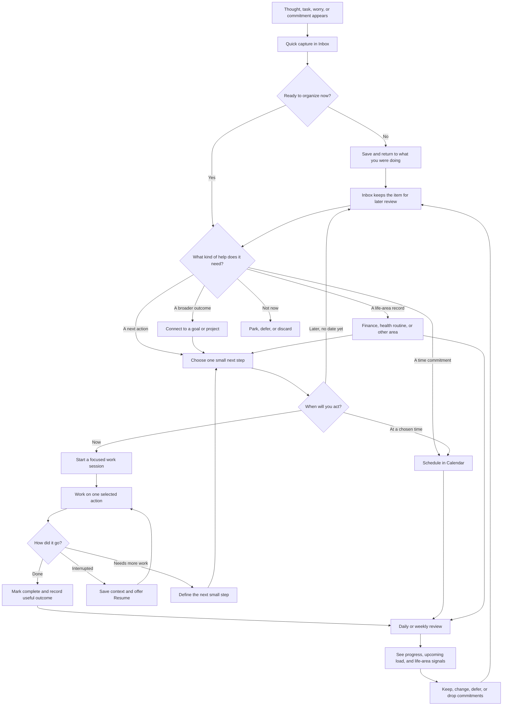

# Perflw Personal Assistant Workflow

**Product direction:** help people move from scattered thoughts and competing life demands to a clear next step, a workable plan, focused action, and useful reflection.

**Research checked:** 22 October 2026. Findings below are design inputs, not claims that every generation or person behaves the same way.

## Product outcome

Perflw should feel like a calm, dependable place to put things down and pick the right thing back up. It should help a person:

1. Capture a thought quickly, before deciding what it means.
2. Turn an idea, concern, or commitment into a concrete next action, a scheduled event, a life-area record, or something intentionally parked.
3. See a manageable plan across projects, responsibilities, personal finances, and health routines.
4. Focus on one chosen action, recover its context after an interruption, and record what happened.
5. Review progress without shame and adjust the next plan.

The product's measure of value is whether it helps users remember commitments, make a suitable plan, resume after interruption, and complete meaningful actions with less effort. Time spent in the app, number of tasks, and notification clicks are not success measures by themselves.

## Design principles

### Capture first; organize in a second, small step

An initial capture should accept plain language without requiring the user to choose a project, date, or category. Triage can happen later, one question at a time. This supports using an external aid for delayed intentions while avoiding a lengthy form at the moment an idea appears.

### Make the next action concrete

When a user is ready, help them identify a first visible action and, when useful, when or where it will happen. Research on implementation intentions finds benefits across cognitive, emotional, and behavioral outcomes; effects were stronger when plans used an if-then structure, the person was motivated, and the plan was rehearsed. The interface can offer a prompt such as “When will you do this?” without forcing every task into a rigid schedule.

### Keep attention on one chosen step

The home experience should make it easy to identify one next action and the few commitments that matter soon. Other records stay available by search and life area. The user remains in control of what is next; Perflw should explain why an item is surfaced and allow the user to defer, change, or dismiss it.

### Support remembering with useful cues

External reminders can support acting on a delayed intention. A 2026 experiment also found that offloading a prospective-memory task did not improve memory for a different concurrent task, and performance on the offloaded task fell when reminders were removed. Perflw should be described as helping users externalize and retrieve commitments, not as training or improving memory automatically. A reminder should say what to do and include enough context to recognize why it matters.

### Treat interruption as a normal state

When someone returns, show the last chosen action, its project or life area, and the next small step. Offer resume, revise, or park. Do not imply failure, generate a large backlog of alerts, or require the user to reconstruct context from memory.

### Review with feedback, not judgment

Show completed work, time, and upcoming commitments as information the user can act on. For health routines, research supports self-monitoring and feedback as common behavior-change techniques, while the best form of feedback remains uncertain. Let users choose what they track and use neutral language.

### Personalize across life areas

People can combine work and personal responsibilities differently. Let them decide which areas appear, how much detail they track, and which kinds of prompts they want. Do not infer a user's needs from their age or generation.

## Proposed end-to-end userflow

The Inbox, quick capture, interruption recovery, and guided review are **proposed workflow capabilities**, not current app features. The flow should be tested with users before it is treated as a settled interaction design.

## User states and intended response

| User state | Perflw response | User control |
|---|---|---|
| An idea arrives while attention is elsewhere | One-step capture; details can wait | Save without classification, or cancel |
| The user has many open commitments | Show a short, useful next-step view; keep the rest searchable | Choose, reorder, defer, or hide suggestions |
| A task is vague or large | Offer to split it into a first action and optionally connect it to a goal/project | Accept, edit, or skip the suggestion |
| The user is ready to act | Open the task's context and a focus action | Start, schedule, or leave unchanged |
| The user is interrupted | Preserve the action and a short resume cue | Resume, revise, or park |
| A commitment cannot be completed | Make rescheduling or reducing scope easy | Reschedule, break down, or drop it without a penalty tone |
| The user reviews a day or week | Summarize what moved, what remains, time/finance/health records they opted into, and conflicts | Keep, change, defer, or remove commitments |

## Proposed weekly planning flow

1. **Empty the head:** review uncategorized captures and decide which still matter.
2. **Choose outcomes:** select a small number of meaningful results for the coming week, including personal responsibilities the user wants to include.
3. **Make actions:** break outcomes into next actions; connect actions to projects or goals when useful.
4. **Check capacity:** place time-specific commitments in Calendar, then review the remaining workload and leave room for rest and unexpected events.
5. **Choose a starting point:** identify the first action for the next work period.
6. **Close the loop:** at the next review, note progress and adjust. Incomplete items are decisions to revisit, not a score of personal worth.

The user should be able to skip the review, keep it short, and change its cadence. Perflw should not treat a weekly plan as a fixed promise when circumstances change.

## Research signals and design implications

| Evidence | What it suggests for Perflw | Limits |
|---|---|---|
| Deloitte's 2026 global survey included more than 22,500 Gen Z and millennial respondents across 44 countries. It reports cost of living as the top concern and describes priorities around stability, skills, and well-being. | Make life management cross-domain: work planning, money, learning, and well-being can compete for the same attention and time. Support flexible progress rather than only rapid achievement. | This is a survey of two generations, not a universal user profile or a causal study of app behavior. |
| A 2025 NORC/Humankind survey of 1,121 U.S. adults reported that stress affected or distracted 79% of surveyed Gen Z workers aged 18–29; focus/concentration, motivation, and decision-making were frequently affected. | Reduce planning friction, make a short next step visible, and make returning after interruption straightforward. | The result concerns U.S. workers in this particular survey; it should not be generalized to all young adults or to users in other countries. |
| A 2025 meta-analysis of 642 tests found implementation intentions had effects across cognitive, affective, and behavioral outcomes; contingent if-then plans, motivation, and rehearsal were associated with larger effects. | Offer optional prompts that connect a cue or time to an action, such as “After lunch, I will review the project brief.” | A research effect does not establish that a particular Perflw UI will work; validate the prompts with users. |
| A 2024 systematic review and meta-analysis of adult randomized trials describes self-monitoring and feedback as behavior-change strategies for diet and physical activity, and notes that more research is needed on the most effective feedback forms. | If health/exercise tracking is added, let users opt in, choose measures, and receive neutral, understandable feedback. | This does not justify medical advice, diagnosis, or assuming that tracking helps everyone. |
| A 2026 prospective-memory experiment found reminders supported the intention that had been offloaded, but did not improve another concurrent intention; removing reminders later reduced performance on the offloaded task. | Provide dependable, contextual retrieval cues and a review practice; do not claim reminders alone improve retention or create stronger memory. | This is experimental evidence from specific tasks, not a complete account of everyday desktop-assistant use. |

## Map to the current Perflw app

| Proposed workflow | Current implementation | Status |
|---|---|---|
| Account setup and a personal workspace | Local registration/login, profile setup, session restoration, and account-scoped local records | Existing foundation |
| Home view of commitments and progress | Home summaries for events, pending tasks, focus time, expenses, and task progress | Existing, but not a unified next-action inbox |
| Capture an idea without deciding its category | Planner has task capture; global search finds existing pages and records | Partial; a unified quick-capture Inbox is absent |
| Organize projects, goals, tasks, and milestones | Projects, Goals, Planner sections, task priority/deadline/completion, milestones | Existing |
| Turn a task into a scheduled commitment | Planner Schedule opens Calendar and links a task with its event | Existing |
| Focus on a task, then keep a record of time | Task-linked timer, pause/resume/stop/switch, manual time entry, notes | Existing |
| Manage personal finance | PHP accounts, categories, income, expenses, transfers, reporting, CSV export, JSON merge restore | Existing |
| Manage health and exercise routines | No dedicated health or exercise section found in current navigation or workspace schema | Future direction |
| Recover from distraction and resume with context | Timer persistence and task links preserve some work context | Partial; no dedicated interruption/re-entry flow found |
| Ask an assistant to sort, recall, or plan | Chat session entries can be managed | Not available; assistant messaging is not connected |
| Review the week and rebalance life areas | Analytics summarizes saved records | Partial; no guided weekly review or cross-domain planning flow found |

## Observable product outcomes to evaluate

Use user research and opt-in product measures to evaluate whether the workflow helps. Establish a baseline before setting targets.

- **Capture-to-decision:** can users save a thought quickly and later decide what to do with it?
- **Decision-to-action:** can users identify a small next step and either begin it or schedule it?
- **Return after interruption:** can users resume the chosen task without reconstructing its context?
- **Plan recovery:** can users reschedule, split, or drop work when a plan changes, without accumulating confusing duplicate items?
- **Review usefulness:** can users identify progress and choose a sensible adjustment in a short weekly review?
- **Cross-domain clarity:** can users see relevant schedule, project, finance, and opted-in health commitments without an overwhelming dashboard?

Do not optimize for longer sessions, more tracked metrics, or more notifications. Collect only measures needed to answer these questions, explain them, and keep any sensitive health or financial information under the user's control.

## Sources

1. Deloitte Global, [2026 Gen Z and Millennial Survey](https://www.deloitte.com/global/en/about/press-room/deloitte-2026-gen-z-and-millennial-survey.html), published 13 May 2026.
2. NORC at the University of Chicago, [Quality of Life Study Finds Stress & Social Support Are Reshaping Work Performance](https://www.norc.org/research/library/quality-of-life-study-finds-stress-social-support-reshaping-work-performance.html), published 29 October 2025.
3. Sheeran, Listrom, and Gollwitzer, [The when and how of planning: Meta-analysis of the scope and components of implementation intentions in 642 tests](https://doi.org/10.1080/10463283.2024.2334563), *European Review of Social Psychology*, published online 27 March 2024.
4. Krukowski, Denton, and König, [Impact of feedback generation and presentation on self-monitoring behaviors, dietary intake, physical activity, and weight](https://doi.org/10.1186/s12966-023-01555-6), *International Journal of Behavioral Nutrition and Physical Activity*, published 4 January 2024.
5. Fellers and Storm, [Offloading reduces prospective memory learning](https://pubmed.ncbi.nlm.nih.gov/42241083/), *Journal of Experimental Psychology: Learning, Memory, and Cognition*, published online 4 June 2026.

